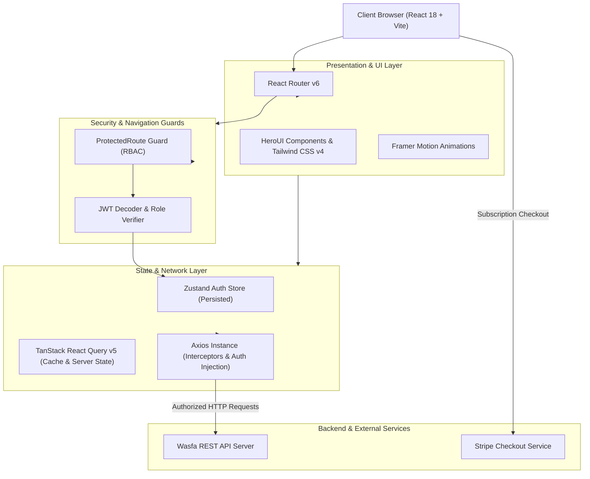
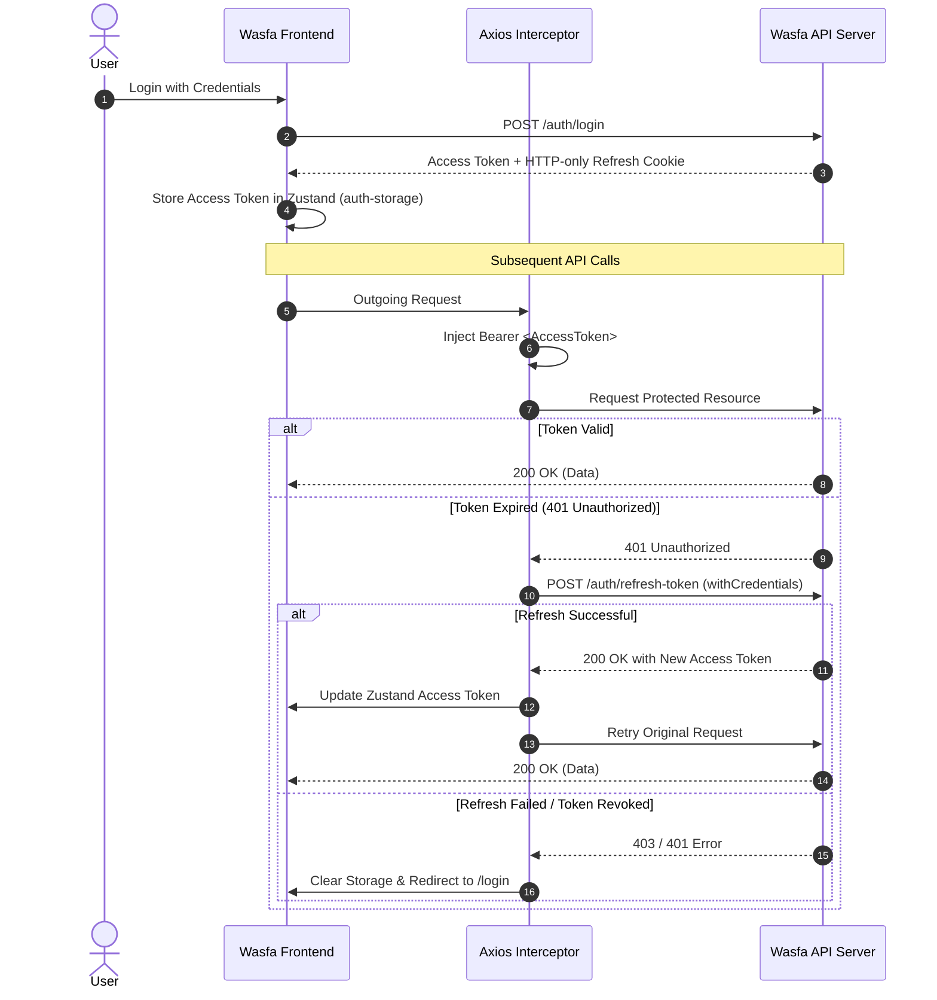

# 🍽️ Wasfa (وصفة) — Modern Recipe & Culinary Management Platform

[](https://react.dev/)
[](https://www.typescriptlang.org/)
[](https://vitejs.dev/)
[](https://tailwindcss.com/)
[](https://heroui.com/)
[](https://tanstack.com/query/latest)
[](https://github.com/pmndrs/zustand)
[](https://stripe.com/)
[](LICENSE)

**Wasfa (وصفة)** is a modern, full-featured recipe discovery, culinary management, and meal-planning platform. Designed with a modular, feature-first architecture, Wasfa empowers home cooks and food lovers to find delicious recipes tailored to the ingredients in their pantry, save their favorite meals, participate in a community review ecosystem, and unlock exclusive chef-curated culinary creations via tiered subscription plans.

It also features a full-fledged **Admin Management Portal** for system moderation, content curation, user access governance, and platform analytics.

---

## 📑 Table of Contents

- [Key Features](#-key-features)
  - [Discovery & Culinary Experience](#discovery--culinary-experience)
  - [Smart Ingredient-Based Search](#smart-ingredient-based-search)
  - [Social & Community Reviews](#social--community-reviews)
  - [Monetization & Multi-Tier Subscriptions](#monetization--multi-tier-subscriptions)
  - [Account & Profile Management](#account--profile-management)
  - [Admin Moderation Dashboard](#admin-moderation-dashboard)
  - [Smart Advertising System](#smart-advertising-system)
- [System Architecture](#-system-architecture)
  - [High-Level Architecture Diagram](#high-level-architecture-diagram)
  - [Authentication & Token Refresh Lifecycle](#authentication--token-refresh-lifecycle)
  - [Route Guarding & Role-Based Access Control (RBAC)](#route-guarding--role-based-access-control-rbac)
- [Tech Stack](#-tech-stack)
- [Project Directory Structure](#-project-directory-structure)
- [Environment Configuration](#-environment-configuration)
- [Getting Started](#-getting-started)
  - [Prerequisites](#prerequisites)
  - [Installation](#installation)
  - [Running Development Server](#running-development-server)
  - [Building for Production](#building-for-production)
- [License](#-license)

---

## ✨ Key Features

### Discovery & Culinary Experience
- **Interactive Recipe Catalog**: Browse through an extensive gallery of curated recipes with real-time sorting (by name, cooking time, rating, newest) and filtering (difficulty level, dietary type, premium/free).
- **Comprehensive Recipe Breakdown**: Step-by-step cooking instructions, ingredient checklists, preparation and cooking times, serving sizes, and difficulty tags (Easy, Intermediate, Hard).
- **Responsive Layout**: Fluid experience optimized for desktops, tablets, and mobile devices with custom hero sections and animations.

### Smart Ingredient-Based Search
- **Pantry Tag Aggregator**: Dynamic multi-ingredient input tag system ("What ingredients do you have?").
- **Zero-Waste Cooking**: Query and filter recipes that match available household ingredients.

### Social & Community Reviews
- **5-Star Rating System**: Users can rate and submit detailed reviews for any recipe.
- **Review Moderation & Editing**: Users can create, update, or remove their own reviews with instant UI updates.
- **Calculated Averages**: Dynamically calculates aggregated recipe rating scores.

### Monetization & Multi-Tier Subscriptions
- **Flexible Membership Tiers**:
  - **Free**: Access to basic recipes, basic search (10/month), community ratings, supported by non-intrusive ads.
  - **Basic ($9.99/mo)**: 50 searches/month, access to extended recipes, advanced filters, save up to 10 favorites, priority email support.
  - **Pro ($19.99/mo)**: Unlimited searches, full access to premium recipes, unlimited ingredient search, save up to 20 favorites, completely ad-free, early access to new features.
- **Stripe Checkout Integration**: Seamless payment processing redirecting to Stripe sessions with webhook-ready fulfillment.
- **Premium Content Gatekeeper**: Automatically intercepts unauthorized non-premium requests to premium recipes with dedicated upgrade portals (`/upgrade`).

### Account & Profile Management
- **User Dashboard (`/profile`)**: Displays user membership status, subscription details, account tenure, aggregate activity stats, recent comments, and saved favorite recipes.
- **Favorites Collection**: Quick access to bookmarked recipes with tier-based quota validation.
- **Account Status Guarding**: Instant redirect to a dedicated Account Suspension screen (`/banned`) for restricted accounts, complete with direct support contact links.

### Admin Moderation Dashboard (`/admin`)
- **Executive Overview**: Real-time KPI summary cards (Total Users, Total Recipes, Total Reviews, Active Subscriptions) and chronological platform activity audit feeds.
- **User Governance**: Searchable user index with status filters (active, banned, verified, unverified) and role-based permissions (admin/user). Ability to toggle user bans and delete accounts.
- **Recipe Management**: Create, edit, and delete recipes with multipart/form-data image uploads, category assignments, and premium flag toggles.
- **Review Moderation**: Global review feed with sorting by rating or publication date, and one-click moderation deletion.

### Smart Advertising System
- **Contextual Ad Engine**: Probabilistic popup modal (`AdPopup`) triggered on page navigations for free-tier users.
- **Ad-Free Exemption**: Automatically disabled for Pro subscribers, authenticated administrators, and sensitive authentication routes.

---

## 🏛️ System Architecture

### High-Level Architecture Diagram



---

### Authentication & Token Refresh Lifecycle

Wasfa implements secure JWT authentication paired with silent refresh token rotation:



---

### Route Guarding & Role-Based Access Control (RBAC)

The application enforces fine-grained authorization policies using declarative layout routes and the custom `ProtectedRoute` wrapper:

| Route Path | Access Level | Description |
| :--- | :--- | :--- |
| `/` | Public | Homepage featuring Hero, Recipe Gallery, and How It Works |
| `/recipe/:id` | Public / Tier-Gated | Recipe details; redirect to `/upgrade` if premium recipe & free user |
| `/search` | Public | Ingredient-based recipe finder |
| `/plans` | Public (User Only) | Subscription comparison and purchase options (Admin redirected to `/`) |
| `/profile` | Authenticated Users | User dashboard, subscription card, stats, recent reviews |
| `/favorites` | Authenticated Users | Bookmarked recipes with tier quota restrictions |
| `/upgrade` | Public | Upsell and upgrade call-to-action for locked content |
| `/admin` | Administrators Only | Analytics overview and system telemetry |
| `/admin/users` | Administrators Only | User management, status updates, and ban controls |
| `/admin/recipes` | Administrators Only | Recipe catalog authoring, image uploads, and updates |
| `/admin/reviews` | Administrators Only | Global review moderation and removal |
| `/banned` | Suspended Users | Account restriction notices with appeal/support actions |

---

## 🛠️ Tech Stack

| Category | Technology | Purpose |
| :--- | :--- | :--- |
| **Framework & Build** | [React 18](https://react.dev/), [Vite 6](https://vitejs.dev/) | High-performance Single Page Application core |
| **Language** | [TypeScript 5](https://www.typescriptlang.org/) | Type safety and robust domain modelling |
| **Design & UI** | [HeroUI v2](https://heroui.com/), [Tailwind CSS v4](https://tailwindcss.com/) | Accessible, modern component library and styling system |
| **Animations** | [Framer Motion 11](https://www.framer.com/motion/) | Smooth UI transitions, modals, and celebration states |
| **Icons** | [Lucide React](https://lucide.dev/) | Clean, consistent vector iconography |
| **Server State** | [TanStack React Query v5](https://tanstack.com/query/latest) | Asynchronous data fetching, caching, and cache invalidation |
| **Client State** | [Zustand v5](https://github.com/pmndrs/zustand) | Lightweight, persisted client state management (Auth) |
| **Form Handling** | [React Hook Form](https://react-hook-form.com/) & [Zod](https://zod.dev/) | Declarative form state and type-safe schema validation |
| **Networking** | [Axios](https://axios-http.com/) | HTTP client with automatic JWT injection and 401 retry interceptor |
| **Auth Parsing** | [jwt-decode](https://github.com/auth0/jwt-decode) | Client-side JWT inspection for role verification |
| **Payments** | [Stripe](https://stripe.com/) | Subscription checkout session integration |

---

## 📂 Project Directory Structure

```text
Wasfa/
├── public/                     # Static assets & icons
├── src/
│   ├── common/                 # Shared foundational architecture
│   │   ├── api/                # Axios instance & token refresh interceptor
│   │   ├── components/         # Reusable widgets (Header, Footer, RecipeCard, Skeletons)
│   │   ├── hooks/              # Global utility hooks (e.g., useLogout)
│   │   ├── interfacess/        # Common interfaces & request configs
│   │   ├── layout/             # MainLayout, AdminLayout, and navigation bars
│   │   └── types/              # Domain entities (Recipe, Review, etc.)
│   ├── features/               # Domain-driven feature modules
│   │   ├── admin/              # Admin dashboard, users, recipes, and reviews moderation
│   │   │   ├── overview/       # KPI stats & activity audit
│   │   │   ├── recipes/        # Recipe authoring, update modals, and image uploads
│   │   │   ├── reviews/        # Review moderation tables and filters
│   │   │   └── users/          # User list, ban toggles, and role controls
│   │   ├── ads/                # Sponsored ad popups and mock ad engine
│   │   ├── auth/               # Login, registration, password recovery, Zustand store
│   │   ├── ban/                # Account suspension landing view
│   │   ├── favoriteRecipes/    # Saved recipe collection
│   │   ├── home/               # Hero section, how-it-works, recipe gallery
│   │   ├── notFound/           # 404 error page
│   │   ├── plans/              # Subscription plans, Stripe checkout, success/cancel pages
│   │   ├── premiumRecipes/     # Premium card showcases
│   │   ├── profile/            # User profile, statistics, and comment management
│   │   ├── recipe/             # Recipe details, instructions, review form & rating list
│   │   └── search/             # Multi-ingredient pantry search view
│   ├── routes/                 # ProtectedRoute guards and routing rules
│   ├── styles/                 # Global styles and Tailwind imports
│   ├── App.tsx                 # Route definitions and provider bootstrapping
│   ├── main.tsx                # Entry point
│   └── provider.tsx            # Global provider wrapper (HeroUI, QueryClient)
├── index.html                  # HTML entry point
├── package.json                # Project dependencies and npm scripts
├── tsconfig.json               # TypeScript configuration
├── vite.config.ts              # Vite build setup with path aliases (@/)
└── tailwind.config.js          # Tailwind CSS theme configuration
```

---

## 🔐 Environment Configuration

Create a `.env` file in the root directory and configure the following variables:

```env
# Backend API Base URL — keep it relative. In dev, Vite proxies /api to localhost:3000;
# in production, vercel.json rewrites /api to the Render backend (keeps the auth cookie first-party).
VITE_BASE_URL=/api

# Stripe Subscription Price IDs
VITE_STRIPE_BASIC_PLAN_PRICE_ID=price_basic_xxxxxxxxx
VITE_STRIPE_PRO_PLAN_PRICE_ID=price_pro_xxxxxxxxx

# Support Contact
VITE_SUPPORT_EMAIL=support@wasfa.example.com
```

---

## 🚀 Getting Started

### Prerequisites

Ensure you have one of the following package managers installed:
- **Node.js** (v18.0.0 or higher recommended)
- **npm**, **yarn**, **pnpm**, or **bun**

### Installation

1. **Clone the repository:**
   ```bash
   git clone https://github.com/MoMedhat10/Wasfa.git
   cd Wasfa
   ```

2. **Install dependencies:**
   ```bash
   npm install
   # or with pnpm:
   # pnpm install
   ```

3. **Configure Environment:**
   ```bash
   cp .env.example .env
   # Add your specific API URL and Stripe Price IDs in .env
   ```

### Running Development Server

Start the local Vite development server:

```bash
npm run dev
```

Open [http://localhost:5173](http://localhost:5173) in your browser to view the application.

### Building for Production

Compile TypeScript and build the optimized production bundle:

```bash
npm run build
```

Preview the production build locally:

```bash
npm run preview
```

### Code Quality & Linting

Run ESLint to check and fix formatting/lint errors:

```bash
npm run lint
```

---

## 📄 License

This project is licensed under the [MIT License](LICENSE).
